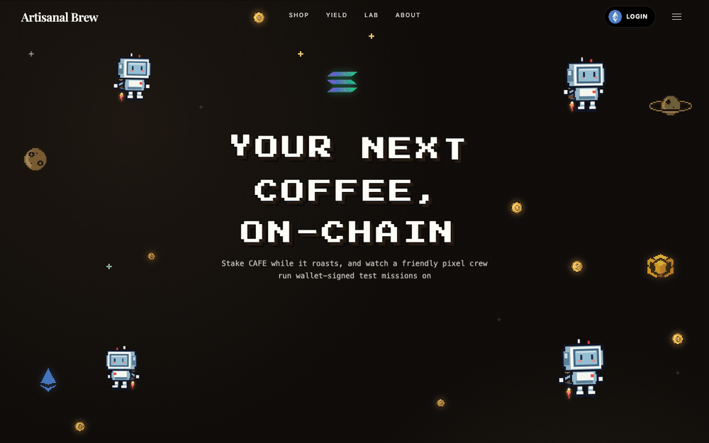

<div align="center">

# ArtisanalBrew



_A fictional coffee storefront with multichain liquid staking and x402 agent commerce._

</div>

Run locally with Docker:

```bash
git clone https://github.com/AlejoReyna/ArtisanalBrew.git
cd ArtisanalBrew
cp .env.example .env
# Fill in the database and admin values in .env before starting.
docker compose up --build
```

Open [localhost:8080](http://localhost:8080).

<sub>[Live demo](https://cafe.alexisrs.dev/) · [Technical reference](./DEVELOPMENT.md)</sub>
