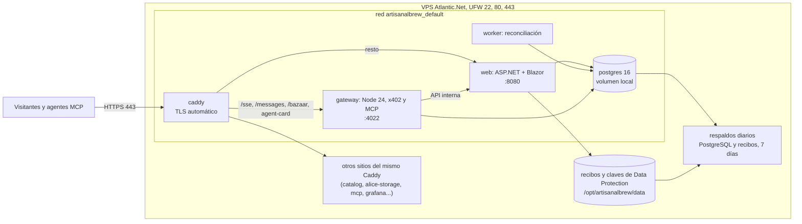
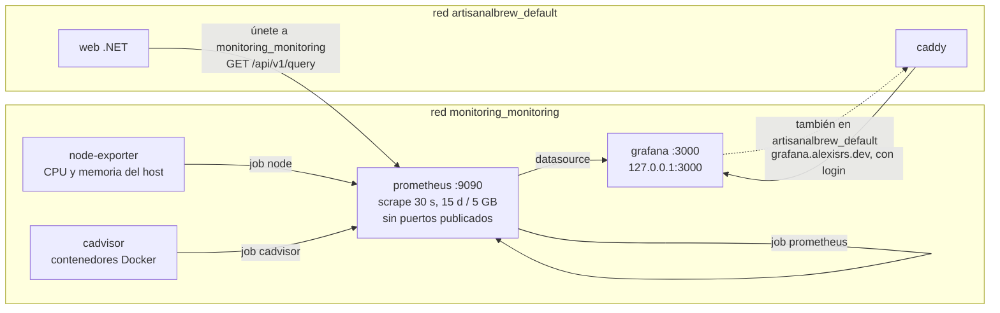
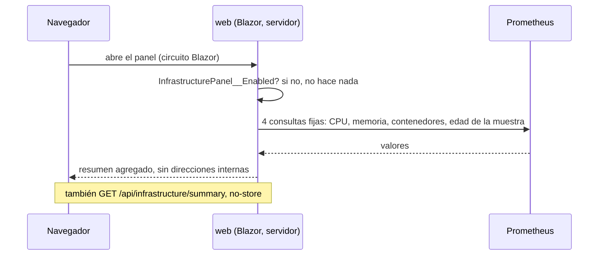
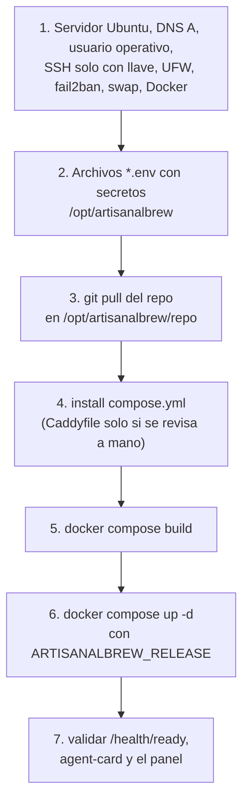
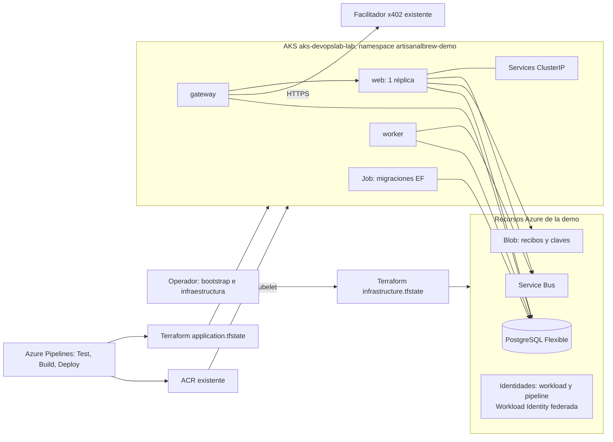
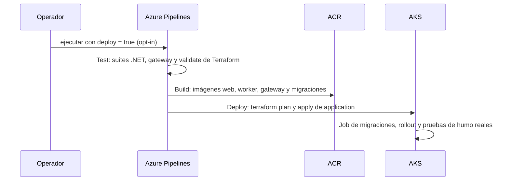

# Infraestructura de ArtisanalBrew: diagramas

Qué corre dónde, cómo se instala y configura, y cómo se conectan Prometheus y Grafana.

| Entorno | Tecnología | Estado |
|---|---|---|
| **Producción** `cafe.alexisrs.dev` | VPS Atlantic.Net con **Docker Compose** (no Kubernetes) | en producción |
| **Demo AKS** | Kubernetes en Azure (AKS) con Terraform y Azure DevOps | demo aislada; su código vive en la rama `k8s` y **aún no está en `main`** (`deployments/aks/`, `infra/terraform/`) |
| Azure Container Apps | Bicep en `infra/` | desactivado salvo `ENABLE_AZURE_DEPLOY=true` |

**Ansible no se usa en este repositorio.** El VPS se aprovisionó a mano y se actualiza con Compose
(sección 5); la demo AKS usa Terraform. No hay playbooks ni inventarios.

Índice: [1. Producción](#1-producción-atlantic-vps) · [2. Prometheus y Grafana](#2-prometheus-y-grafana-en-el-vps) ·
[3. Instalación y configuración del VPS](#3-instalación-y-configuración-del-vps) ·
[4. Kubernetes (demo AKS)](#4-kubernetes-demo-aks) · [5. Ansible](#5-ansible)

## 1. Producción (Atlantic VPS)



- Solo Caddy publica puertos; `web` y `gateway` usan `expose` dentro de la red de Compose.
- Cada servicio tiene límites de CPU y memoria y `restart: unless-stopped`.
- El `Caddyfile` **activo** del servidor sirve además sitios de otros proyectos. No se instala desde el
  repo sobre el activo (el del repo no los contiene).

## 2. Prometheus y Grafana en el VPS

El stack de monitoreo está **fuera de este repo**, en `/opt/monitoring` (proyecto Compose `monitoring`).



- **Prometheus** solo está en `monitoring_monitoring` y no publica puertos. **Grafana** está en esa red y en
  `artisanalbrew_default`, escucha en `127.0.0.1:3000` y Caddy la publica en `grafana.alexisrs.dev` con login.
- **`web` se une a `monitoring_monitoring`** (en `deployments/atlantic/compose.yml`, red `external`) además de
  `default`, así llega a `http://prometheus:9090`. Esa red también contiene node-exporter, cAdvisor y Grafana.

### Panel «Infraestructura» de la web



Si Prometheus no responde, el panel muestra «Sin conexión»; el sitio y el carrito no se ven afectados.
Con `InfrastructurePanel__Enabled=false`, el botón y el panel no se renderizan y no hay consultas.

## 3. Instalación y configuración del VPS

Disposición en el servidor:

| Ruta | Propósito |
|---|---|
| `/opt/artisanalbrew/repo` | checkout de la aplicación |
| `/opt/artisanalbrew/compose.yml` | Compose activo (copia de `deployments/atlantic/compose.yml`) |
| `/opt/artisanalbrew/Caddyfile` | proxy activo (no se sobrescribe desde el repo) |
| `/opt/artisanalbrew/*.env` | secretos, propiedad de `root`, 0600 |
| `/opt/artisanalbrew/data/{postgres,receipts,dataprotection}` | volúmenes persistentes |
| `/opt/monitoring/` | stack de monitoreo (Prometheus, node-exporter, cAdvisor, Grafana) |



Despliegue de una revisión aprobada (ver también `docs/atlantic-migration.md`):

```bash
cd /opt/artisanalbrew/repo && git pull --ff-only
sudo docker network inspect monitoring_monitoring >/dev/null
sudo install -m 0644 deployments/atlantic/compose.yml /opt/artisanalbrew/compose.yml
sudo docker compose -f /opt/artisanalbrew/compose.yml build web
sudo env ARTISANALBREW_RELEASE="$(git rev-parse --short=12 HEAD)" \
  docker compose -f /opt/artisanalbrew/compose.yml up -d web
```

Configuración del panel, en `/opt/artisanalbrew/web.env`:

| Variable | Valor en producción |
|---|---|
| `InfrastructurePanel__Prometheus__BaseUrl` | `http://prometheus:9090` |
| `InfrastructurePanel__Grafana__Url` | `https://grafana.alexisrs.dev` (o `Grafana__Private=true` sin enlace) |

Las demás (`Provider=atlantic`, `Environment=production`, `Release`) las fija `compose.yml`. Referencia
completa en [infrastructure-panel.md](infrastructure-panel.md).

## 4. Kubernetes (demo AKS)

> Esta parte describe la rama `k8s` (`deployments/aks/README.md`, `infra/terraform/`,
> `azure-pipelines.yml`), todavía sin fusionar a `main`. Es una **demo aislada**, no producción.

### 4.1 Topología



- Dos estados de Terraform en contenedores Blob separados: `infrastructure.tfstate` (identidades, PostgreSQL, Service Bus,
  contenedores Blob, RBAC) y `application.tfstate` (namespace, ConfigMaps, Job de migración, Deployments y Services).
- Los Deployments usan `strategy: Recreate` (las sesiones de Blazor y MCP y la reconciliación del worker son locales al proceso).
- AKS, ACR y la cuenta de estado se **reutilizan** con `data sources`; no se importan ni se recrean.

### 4.2 Pipeline



### 4.3 Instalación (resumen del runbook)

Orden de `deployments/aks/README.md`: inventario y herramientas → backend remoto (dos contenedores de
estado, con permisos de datos Blob para el operador) → `infra/terraform/infrastructure` → credenciales de
kubectl y namespace → secretos (`scripts/aks/`) → Azure DevOps (service connection federada, environment,
variable group) → primera ejecución → verificación, pausa y eliminación.

```bash
terraform -chdir=infra/terraform/infrastructure init -backend-config=backend.hcl   # backend.hcl desde el .example
```

Acceso a la web de la demo: `kubectl -n artisanalbrew-demo port-forward svc/web 8080:<puerto>` (el comando exacto
sale de la salida `web_access` de Terraform).

### 4.4 Monitoreo en AKS

**No hay Prometheus ni Grafana en AKS** (solo metrics-server y componentes de sistema). Con
`InfrastructurePanel__Provider=azure` el panel muestra «Azure · AKS» pero Prometheus aparece «Sin configurar».
Para mostrar «Pods listos» hace falta una fuente propia (Prometheus + kube-state-metrics, o Azure Managed Prometheus)
y fijar `InfrastructurePanel__Prometheus__BaseUrl` y `__Namespace`. Mientras tanto, las métricas de plataforma se
ven en Azure Portal → Kubernetes services → Monitoring → Metrics (`deployments/aks/dashboard.md`).

## 5. Ansible

No existe. Para quien lo busque, esto es lo que cubre cada necesidad hoy:

| Necesidad | Herramienta actual |
|---|---|
| Aprovisionar el VPS | pasos manuales documentados en `docs/atlantic-migration.md` |
| Configurar y desplegar en el VPS | Docker Compose + `install` de `compose.yml` |
| Infraestructura de la demo | Terraform (`infra/terraform/*`) |
| CI/CD de la demo | Azure Pipelines (`azure-pipelines.yml`) |
